# GameDev Learning Path — program v3

Java i JavaScript korzystają z identycznego manifestu 24 lekcji i generatora projektów. Po pierwszych pięciu lekcjach uczeń ma sterowanie, collidery, pościg i walkę z HP.

| Nr | Lekcja | Czego uczy |
|---|---|---|
| 1 | Scena, obiekty i komponenty | Rozróżniasz obiekt, jego Transform i komponent wyglądu. Tworzysz dwie niezależne instancje i odczytujesz pozycję obiektu na mapie. |
| 2 | Sterowanie i kierunek postaci | Rozróżniasz przytrzymanie klawisza i pojedyncze naciśnięcie. Oddzielasz odczyt input od wykonania ruchu przez CharacterController2D. Odczytujesz ostatni niezerowy kierunek z CharacterController2D.getDirection(), także po zatrzymaniu postaci. |
| 3 | Collidery, przeszkody i granice świata | Odróżniasz renderer od fizycznego kształtu i triggera. Używasz kontrolera do blokowania ruchu i ślizgania przy przeszkodach. |
| 4 | Pierwszy przeciwnik i pościg | Uruchamiasz pościg za graczem przez komponent EnemyAI. Obliczasz kierunek do celu, korzystając z gotowego kontrolera; następnie samodzielnie piszesz pościg i ucieczkę. |
| 5 | Pociski, HP i pierwsza pętla walki | Strzelasz zgodnie z ostatnim kierunkiem ruchu, odczytanym z CharacterController2D.getDirection(). Pocisk odbiera HP, przeciwnik znika po śmierci, a kontakt wroga odbiera HP graczowi. Gotowe komponenty później rozbudujesz. |
| 6 | Własna klasa komponentu i cykl życia | Piszesz klasę dziedziczącą po Component i dodajesz jej instancję do obiektu. Odróżniasz stan instancji od wspólnego stanu oraz tworzenie od aktualizacji i usuwania. |
| 7 | Czas, wektory i stała prędkość | Liczysz przesunięcie jako prędkość razy czas. Normalizujesz wektor kierunku i obsługujesz wektor zerowy. |
| 8 | Sprite, kafelki, odbicie i warstwy | Dobierasz tekstury i jawne wymiary; układasz tło i obiekty. Odbijasz wygląd bez obrotu lub zmiany kolizji. |
| 9 | Fale, konfiguracja i powtarzalny spawn | Tworzysz obiekty według harmonogramu czasu symulacji. Używasz jawnych danych fali, wspólnego seeda i limitu żywych przeciwników. |
| 10 | Health, obrażenia i nietykalność gracza | Zamykasz reguły zdrowia w komponentach Health na poszczególnych obiektach. Obsługujesz śmierć raz oraz lokalny czas nietykalności, zamiast stanu globalnego gry. |
| 11 | Weapon, cooldown i automatyczny atak | Piszesz Weapon jako komponent gracza korzystający z pocisku z poprzedniego rozdziału. Wybierasz poprawny cel i odmierzasz odstęp strzałów w czasie symulacji. |
| 12 | Triggery, monety i własny Wallet | Rozróżniasz kontakt wykrywający od kontaktu blokującego. Przyznajesz nagrodę raz i przechowujesz walutę we właściwym komponencie. |
| 13 | Śmierć przeciwnika, łup i doświadczenie | Łączysz niezależne komponenty przez jednokrotny sygnał śmierci. Przechowujesz doświadczenie gracza i obliczasz wiele awansów bez utraty nadwyżki. |
| 14 | AI: wykrywanie, flankowanie i ucieczka | Konfigurujesz zasięg wykrywania. Obliczasz kierunek boczny do flankowania i rozbudowujesz ucieczkę. |
| 15 | Kamera i przestrzenie współrzędnych | Odróżniasz pozycję świata, ekran i współrzędne kursora. Śledzisz gracza kamerą bez wpływu na kolizje lub pozycję świata. |
| 16 | Canvas, ręczne rysowanie i HUD | Wiesz, kiedy użyć renderera, a kiedy własnych komend Canvas. Stosujesz centrowane figury, jawne wyrównanie tekstu i UI niezależne od kamery. |
| 17 | Pauza i działające menu | Zatrzymujesz czas świata, zachowując działające UI. Obsługujesz przyciski, focus, klawiaturę i mysz; UI zużywa obsłużone wejście. |
| 18 | Wybór ulepszenia i własne reguły zakupów | Łączysz awans z pauzą i jednorazowym wyborem. Zmieniasz parametry właściwych komponentów; rozróżniasz darmową nagrodę i płatny zakup. |
| 19 | Feedback trafienia, tweeny i floating text | Animujesz jawne właściwości bez ręcznego liczenia każdej klatki. Oddzielasz efekt wizualny od fizyki i rozumiesz zastępowanie oraz czas tweena. Tworzysz tekst obrażeń, animujesz jego pozycję i usuwasz po zakończeniu efektu. |
| 20 | Pociski naprowadzane i przebijające | Rozbudowujesz lot pocisku: kierunek do celu, wiele trafień i sweep przy dużej prędkości. Oddzielasz zachowanie pocisku od broni. |
| 21 | Kompozycja, fabryki i wyposażenie | Budujesz różne jednostki z tych samych komponentów i danych. Przekazujesz referencje zamiast rozbudowywać Game o każdy parametr rozgrywki. |
| 22 | Start, przegrana, zwycięstwo i restart | Modelujesz stan całej rozgrywki oddzielnie od stanu komponentów jednostek. Kończysz i uruchamiasz nowy przebieg z poprawnym sprzątaniem. |
| 23 | Wydajność, testowanie i zapis projektu | Mierzysz liczbę aktywnych obiektów, wykonywane operacje i poprawność sprzątania. Optymalizujesz konkretny koszt, zachowując zasady rozgrywki. Eksportujesz cały projekt, sprawdzasz wersję i język przy imporcie; odtwarzasz działającą grę. |
| 24 | Projekt końcowy: Łąka przetrwania | Łączysz mechaniki kursu w kompletną grę survivor. Udowadniasz działanie scenariuszami, pomiarem obciążenia i odtworzeniem wyeksportowanego projektu w swoim języku. |

```mermaid
flowchart TD
  L1["1. Scena, obiekty i komponenty"]
  L2["2. Sterowanie i kierunek postaci"]
  L1 --> L2
  L3["3. Collidery, przeszkody i granice świata"]
  L2 --> L3
  L4["4. Pierwszy przeciwnik i pościg"]
  L3 --> L4
  L5["5. Pociski, HP i pierwsza pętla walki"]
  L4 --> L5
  L6["6. Własna klasa komponentu i cykl życia"]
  L5 --> L6
  L7["7. Czas, wektory i stała prędkość"]
  L6 --> L7
  L8["8. Sprite, kafelki, odbicie i warstwy"]
  L7 --> L8
  L9["9. Fale, konfiguracja i powtarzalny spawn"]
  L8 --> L9
  L10["10. Health, obrażenia i nietykalność gracza"]
  L9 --> L10
  L11["11. Weapon, cooldown i automatyczny atak"]
  L10 --> L11
  L12["12. Triggery, monety i własny Wallet"]
  L11 --> L12
  L13["13. Śmierć przeciwnika, łup i doświadczenie"]
  L12 --> L13
  L14["14. AI: wykrywanie, flankowanie i ucieczka"]
  L13 --> L14
  L15["15. Kamera i przestrzenie współrzędnych"]
  L14 --> L15
  L16["16. Canvas, ręczne rysowanie i HUD"]
  L15 --> L16
  L17["17. Pauza i działające menu"]
  L16 --> L17
  L18["18. Wybór ulepszenia i własne reguły zakupów"]
  L17 --> L18
  L19["19. Feedback trafienia, tweeny i floating text"]
  L18 --> L19
  L20["20. Pociski naprowadzane i przebijające"]
  L19 --> L20
  L21["21. Kompozycja, fabryki i wyposażenie"]
  L20 --> L21
  L22["22. Start, przegrana, zwycięstwo i restart"]
  L21 --> L22
  L23["23. Wydajność, testowanie i zapis projektu"]
  L22 --> L23
  L24["24. Projekt końcowy: Łąka przetrwania"]
  L23 --> L24
```

Zadania: 1. mała zmiana z przykładem i złotym wyróżnieniem; 2. podobny problem samodzielnie; 3. większa rozbudowa. Pliki z gotową bazą pozostają dostępne do czytania i modyfikacji.

Materiały startowe: [Java PDF](../../java-lab/public/courses/kurs-gamedev-java-v3.pdf) i [JS PDF](../../web-learning-lab/public/courses/kurs-gamedev-js-v3.pdf).
